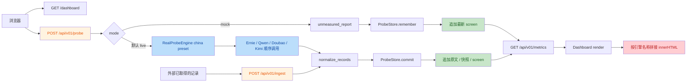
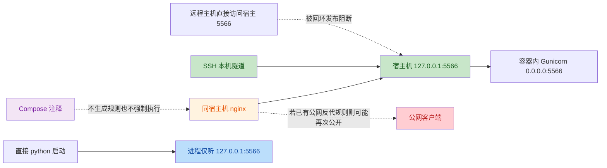

# 闻见AI后端阶段2六项修改文件差异审查报告

- 审查日期：2026-11-23
- 审查性质：准备环节补充任务，只读静态差异审查
- Git 基线：`HEAD 1e45f27339cda931036eccc9e13d5fa9b912d2c9`
- 对照范围：当前工作区版本与上述 HEAD 版本
- 授权边界：本报告不构成正式开发、修复、保留、恢复、提交或上线建议
- 决策状态：六个文件是否保留，全部 **待负责人决策**

> 本次未修改、恢复、复制、移动、覆盖或删除任何既有文件；未执行 Git 写操作；未修复代码；未运行模块导入、测试、数据库操作、服务或部署。报告生成后停止。

---

## 一、结论摘要

1. 六个文件合计 **新增 470 行、删除 2,063 行**。最大变化是 [dashboard.html](file:///Users/nayoo/Documents/trae_projects/GEO/Alpha-Geo/src/dashboard.html) 的整体替换：从 2,069 行综合控制台变为 304 行本机三指标页。
2. 修改横跨六个层面：本机网络边界、本机监测 API、多平台真实探针、查询扇出模板再导出、监测台界面、公开价格与指标措辞。
3. 静态证据支持优先关注四类问题：
   - 新增 `probe/ingest` 路由没有路由自有鉴权，分别可触发真实探测和持久化写入；
   - `ingest` 的引擎名可持久化进入 Dashboard 的未转义 `innerHTML`，形成存储型 HTML 注入/XSS 候选链路；
   - 六项修改依赖多份未跟踪文件，单独交付六个文件不完整；
   - 多平台适配器实际顺序执行，多个 120 秒超时会显著放大整批等待时间，并可能与既有 60 秒 Gunicorn worker 超时冲突。
4. 回环绑定确实降低直接远程暴露面，但会影响既有远程直连和部分反代方式；Compose 注释本身不控制 nginx，同机反代仍可访问回环端口。
5. 价格与禁用术语尚未形成全链路一致口径；其中历史复测记录是否应保持原貌，需负责人区分“现行文档”与“历史快照”。
6. 没有静态证据证明已经发生公网入侵、密钥泄露、线上空响应或数据被恶意利用；本报告不将条件性风险写成已发生事件。
7. 修改来源均不能仅凭代码风格推定。现有任务文档只足以确认 [alpha_geo_multiplatform.py](file:///Users/nayoo/Documents/trae_projects/GEO/Alpha-Geo/src/alpha_geo_multiplatform.py) 中“环境变量兜底”这一子改动的来源与目的，不能覆盖该文件的其他变化。

---

## 二、审查范围、方法与统计口径

### 2.1 六个目标文件

1. [docker-compose.yml](file:///Users/nayoo/Documents/trae_projects/GEO/Alpha-Geo/docker-compose.yml)
2. [alpha_geo_api.py](file:///Users/nayoo/Documents/trae_projects/GEO/Alpha-Geo/src/alpha_geo_api.py)
3. [alpha_geo_multiplatform.py](file:///Users/nayoo/Documents/trae_projects/GEO/Alpha-Geo/src/alpha_geo_multiplatform.py)
4. [alpha_geo_prompt_intel.py](file:///Users/nayoo/Documents/trae_projects/GEO/Alpha-Geo/src/alpha_geo_prompt_intel.py)
5. [dashboard.html](file:///Users/nayoo/Documents/trae_projects/GEO/Alpha-Geo/src/dashboard.html)
6. [llms.txt](file:///Users/nayoo/Documents/trae_projects/GEO/Alpha-Geo/src/site-geo-insight/llms.txt)

### 2.2 方法与限制

- 使用 `git diff`、`git show HEAD:<path>`、`git diff --numstat` 对照工作区和 HEAD。
- 对 Python 新旧版本做过静态 AST 解析，均通过；**AST 通过不等于导入、启动、接口或供应商调用验证通过**。
- 对 Dashboard 做结构、脚本、接口与渲染链对照；对跨文件调用链做只读检索。
- 候选问题由两名相互独立的只读验证员逐项复核；正文标明共识和定级分歧。
- Compose 仅报告端口与结构差异。`env_file`、`environment` 等部分未发现差异，本报告不复制其中任何环境变量值、密码、密钥或令牌。
- 未读取 `.env`，未核验真实密钥类型，未访问供应商接口，未检查生产 nginx 实际运行状态。

### 2.3 增删与“修改”统计口径

Git 的 `numstat` 只提供新增和删除，不单独提供“修改行”。下表的“估算替换行”按 `min(新增, 删除)` 归并，用于观察替换规模；替换两侧已经包含在 Git 增删总数内，不能重复累计。

| 文件 | HEAD 行数 | 工作区行数 | Git 新增 | Git 删除 | 估算替换行 | 估算纯新增 | 估算纯删除 |
|---|---:|---:|---:|---:|---:|---:|---:|
| [docker-compose.yml](file:///Users/nayoo/Documents/trae_projects/GEO/Alpha-Geo/docker-compose.yml) | 55 | 56 | 2 | 1 | 1 | 1 | 0 |
| [alpha_geo_api.py](file:///Users/nayoo/Documents/trae_projects/GEO/Alpha-Geo/src/alpha_geo_api.py) | 948 | 1,032 | 88 | 4 | 4 | 84 | 0 |
| [alpha_geo_multiplatform.py](file:///Users/nayoo/Documents/trae_projects/GEO/Alpha-Geo/src/alpha_geo_multiplatform.py) | 526 | 609 | 95 | 12 | 12 | 83 | 0 |
| [alpha_geo_prompt_intel.py](file:///Users/nayoo/Documents/trae_projects/GEO/Alpha-Geo/src/alpha_geo_prompt_intel.py) | 363 | 367 | 4 | 0 | 0 | 4 | 0 |
| [dashboard.html](file:///Users/nayoo/Documents/trae_projects/GEO/Alpha-Geo/src/dashboard.html) | 2,069 | 304 | 278 | 2,043 | 278 | 0 | 1,765 |
| [llms.txt](file:///Users/nayoo/Documents/trae_projects/GEO/Alpha-Geo/src/site-geo-insight/llms.txt) | 70 | 70 | 3 | 3 | 3 | 0 | 0 |
| **合计** | — | — | **470** | **2,063** | **298** | **172** | **1,765** |

### 2.4 变化类别总览

| 文件 | 业务逻辑 | 配置/部署 | 界面 | 文档/口径 | 安全相关 |
|---|---|---|---|---|---|
| Compose | 间接影响 API 可达性 | **端口发布变化** | 无 | 新增运维注释 | **回环隔离与反代边界** |
| API | **新增 A2A、助手、本机监测路由** | 启动监听地址变化 | 提供 Dashboard HTML | 启动横幅变化 | **CORS、写入与真实调用门禁** |
| 多平台引擎 | **Kimi、Ernie、Qwen、预设与配置变化** | 超时和环境变量读取 | 无 | 注释与调试输出 | **密钥持有面、响应日志、降级语义** |
| Prompt Intel | 模板命名空间再导出 | 新硬依赖 | 无 | 新增来源注释 | 主要是依赖完整性，无直接算法安全变化 |
| Dashboard | **综合控制台替换为三指标监测台** | 无构建配置变化 | **整体替换** | 产品状态与禁词文案 | **未转义 HTML、请求错误处理** |
| llms.txt | 公开价格变化 | 无 | 无 | **价格与禁用术语变化** | 运行护栏口径同步问题 |

---

## 三、关键变化流程图

### 3.1 新增本机监测数据流

### 3.2 回环发布与反代边界

---

## 四、六文件逐项差异审查

## 4.1 `Alpha-Geo/docker-compose.yml`

### A. 完整结构差异

仅 `api` 服务的 `ports` 有一处替换和一条新增注释：

| 项目 | HEAD | 工作区 |
|---|---|---|
| 端口发布 | `5566:5566`，宿主机各可用接口发布到容器 5566 | `127.0.0.1:5566:5566`，仅宿主机 IPv4 回环地址发布 |
| 注释 | 无 | 新增“仅本机；公网 nginx 不得再把 `/dashboard` 反代上来” |
| 其他服务、卷、健康检查、`env_file`、`environment` | — | 本次无差异 |

未输出也未复制任何环境变量值。

### B. 变化性质

- **配置**：宿主机端口发布范围收窄。
- **安全**：直接远程访问宿主 5566 的路径被阻断；同机进程、SSH 隧道和同机 nginx 仍可访问。
- **业务**：变化作用于整个 `api` 服务，不只作用于 `/dashboard`。依赖远程直连的全部既有 API 都受影响。
- **界面/文档**：无界面代码变化；新增的是运维约束注释。

### C. 受影响模块与兼容性

- [alpha_geo_api.py:1025-1032](file:///Users/nayoo/Documents/trae_projects/GEO/Alpha-Geo/src/alpha_geo_api.py#L1025-L1032) 的直接 `python` 启动也改为回环，与 Compose 的本机访问方向一致。
- 默认 [Dockerfile:29-30](file:///Users/nayoo/Documents/trae_projects/GEO/Alpha-Geo/Dockerfile#L29-L30) 使用 Gunicorn 监听容器内 `0.0.0.0`，所以 `app.run()` 不影响默认 Compose 容器内监听；不能误判为“默认容器必然不可达”。
- 同机 nginx 仍可代理到宿主回环端口；异机反代和远程直连会失效。容器网络内访问也不等同于宿主端口发布。
- 既有部署脚本仍有公网地址/安全组放行导向，需核对是否仍属于现行部署方式。
- [dashboard_本地不上线_fxlx.md](file:///Users/nayoo/Documents/trae_projects/GEO/Alpha-Geo/docs/dashboard_本地不上线_fxlx.md) 与 [通知_dashboard本地不上线_五岗.md](file:///Users/nayoo/Documents/trae_projects/GEO/Alpha-Geo/docs/通知_dashboard本地不上线_五岗.md) 明确记录“运营台下公网、仅本机或隧道”的设计背景，可确认回环变更目的与该文档一致；但不能据此确认是谁实施了当前工作区修改。

### D. 不完整实现、调试内容与风险

- 未发现临时调试内容。
- 注释没有技术强制力。本次六文件没有 nginx 规则变更，无法证明公网反代已经按注释移除。
- 回环隔离收益和远程兼容影响均为 **2/2 复核确认**；实际业务中断范围取决于现行客户端和 nginx 部署。

### E. 判断标签

| 项目 | 判断 |
|---|---|
| 修改来源 | **待确认** |
| 修改目的 | **已确认**：限回环及运营台下公网，有现行设计文档对应；具体实施人仍待确认 |
| 业务影响 | **明确**：整个 API 服务的远程直连和部分反代方式受影响 |
| 安全影响 | **明确**：降低直接远程暴露，但不替代鉴权或 nginx 实际规则 |
| 是否建议保留 | **待负责人决策** |

---

## 4.2 `Alpha-Geo/src/alpha_geo_api.py`

### A. 完整差异分组

Git 统计为 **88 增、4 删**；可归纳为六个差异组：

1. **A2A 预注册**：[alpha_geo_api.py:71-76](file:///Users/nayoo/Documents/trae_projects/GEO/Alpha-Geo/src/alpha_geo_api.py#L71-L76)
   - 可选导入并注册 `aao_a2a_routes.register_a2a_preembed_routes`。
   - 异常被捕获并打印，主 API 继续运行。
2. **闻见助手注册**：[alpha_geo_api.py:110-115](file:///Users/nayoo/Documents/trae_projects/GEO/Alpha-Geo/src/alpha_geo_api.py#L110-L115)
   - 可选导入并注册 `assistant_routes.register_assistant_routes`。
   - 同样采用软失败方式。
3. **CORS 请求头扩展**：[alpha_geo_api.py:121-127](file:///Users/nayoo/Documents/trae_projects/GEO/Alpha-Geo/src/alpha_geo_api.py#L121-L127)
   - `Access-Control-Allow-Headers` 新增 `X-KB-Token`、`X-Assistant-Token` 两个名称。
   - `Access-Control-Allow-Origin` 仍为 `*`，该通配本身不是本次新增，但新路由自动继承。
4. **本机监测页面和读接口**：[alpha_geo_api.py:952-978](file:///Users/nayoo/Documents/trae_projects/GEO/Alpha-Geo/src/alpha_geo_api.py#L952-L978)
   - 新增 `_probe_store()`，请求时导入 `engine.ProbeStore`。
   - 新增 `GET /dashboard`，用 `send_file` 提供同目录 Dashboard。
   - 新增 `GET /api/v01/metrics`，返回最新落盘 screen，不在 API 层重算指标。
5. **真实/模拟探测与外部记录落盘**：[alpha_geo_api.py:981-1018](file:///Users/nayoo/Documents/trae_projects/GEO/Alpha-Geo/src/alpha_geo_api.py#L981-L1018)
   - 新增 `POST /api/v01/probe`；字符串 prompts 按行拆分；缺省 `mode="live"`；按报告 `ok` 返回 200 或 422。
   - 新增 `POST /api/v01/ingest`；规范化记录后调用 `ProbeStore.commit`；只在该路由局部捕获 `ValueError`。
6. **直接启动方式与横幅**：[alpha_geo_api.py:1025-1032](file:///Users/nayoo/Documents/trae_projects/GEO/Alpha-Geo/src/alpha_geo_api.py#L1025-L1032)
   - 启动横幅从 Enterprise 全模块描述改为“本机 API · 监测台 M2”。
   - `app.run` 从 `0.0.0.0` 改为 `127.0.0.1`，端口和 debug 开关结构不变。

### B. 重要业务变化

- 主 API 新增本机监测闭环：页面、最新指标、触发探测、外部结果落盘。
- `probe` 默认是 `live`，不是 `mock`。在配置有效时，会经 [alpha_geo_enterprise.py:27-44](file:///Users/nayoo/Documents/trae_projects/GEO/Alpha-Geo/src/alpha_geo_enterprise.py#L27-L44) 进入 `china` 预设真实适配器。
- `ingest` 不是只读接口；[engine.py:434-487](file:///Users/nayoo/Documents/trae_projects/GEO/Alpha-Geo/src/engine.py#L434-L487) 会追加原文、快照和最新 screen。
- A2A 与助手采用可选注册；助手的独立 token/回环鉴权不自动覆盖新增的 `/api/v01/*` 路由。

### C. 安全与数据完整性

- 新增 `metrics/probe/ingest` 未见路由自有 token、写密钥或等效门禁。回环绑定是网络边界，不是请求身份认证。
- 在“用户浏览器能访问本机服务、浏览器私有网络策略允许、请求满足 CORS”的条件下，跨站页面触发本机请求具有代码条件；实际可利用性依赖浏览器和网络环境，未实测。
- 如果同机 nginx、隧道或其他转发把路由再次公开，触达面不再只限本机。
- `probe` 可产生供应商调用和等待成本；`ingest` 可改变最新监测屏并写盘；`metrics` 可读取最新报告。三者需按各自读写风险分别判断。

### D. 新依赖及交付完整性

以下文件当前存在，但 Git 状态均为未跟踪 `??`：

| 新功能 | 依赖 | 缺失时的静态后果 |
|---|---|---|
| A2A 注册 | [aao_a2a_routes.py](file:///Users/nayoo/Documents/trae_projects/GEO/Alpha-Geo/src/aao_a2a_routes.py)、[aao_a2a_preembed.py](file:///Users/nayoo/Documents/trae_projects/GEO/Alpha-Geo/src/aao_a2a_preembed.py) | 导入/注册被 `try/except` 捕获，主 API 可继续，但对应路由不存在 |
| 闻见助手 | [assistant_routes.py](file:///Users/nayoo/Documents/trae_projects/GEO/Alpha-Geo/src/assistant_routes.py)、[geo_assistant_engine.py](file:///Users/nayoo/Documents/trae_projects/GEO/Alpha-Geo/src/geo_assistant_engine.py)、[dashboard_assistant.html](file:///Users/nayoo/Documents/trae_projects/GEO/Alpha-Geo/src/dashboard_assistant.html) | 模块缺失时软注册失败；页面文件单独缺失时对应页面返回 404 |
| v01 监测 | [engine.py](file:///Users/nayoo/Documents/trae_projects/GEO/Alpha-Geo/src/engine.py) | 请求处理内硬导入，主模块可能启动，但 metrics/probe/ingest 请求失败，页面只剩静态壳 |

因此，“只交付六个已跟踪修改文件”不是完整交付单元；若交付机制另行包含这些未跟踪文件，则该风险前提消失。

### E. 受影响模块

- [engine.py](file:///Users/nayoo/Documents/trae_projects/GEO/Alpha-Geo/src/engine.py)：计算、规范化、原文/快照/screen 持久化。
- [alpha_geo_enterprise.py](file:///Users/nayoo/Documents/trae_projects/GEO/Alpha-Geo/src/alpha_geo_enterprise.py)：真实探测入口和 mock 过滤。
- [alpha_geo_multiplatform.py](file:///Users/nayoo/Documents/trae_projects/GEO/Alpha-Geo/src/alpha_geo_multiplatform.py)：默认 live 的底层适配器。
- [dashboard.html](file:///Users/nayoo/Documents/trae_projects/GEO/Alpha-Geo/src/dashboard.html)：新路由的直接消费者。
- A2A、助手、知识库相关前端：受新增路由和 CORS 请求头影响。
- Docker、SSH 隧道、nginx、远程 API 客户端：受监听与发布边界影响。

### F. 不完整实现、调试内容与兼容性

- **交付不完整候选**：必要依赖未跟踪，且软注册可能让功能缺失只表现为日志或 404。
- 未发现本差异新增 print 属于临时调试；启动横幅和注册日志具有明确运行状态用途。
- 新旧 Python 版本 AST 均可解析，但未验证这些可选模块能否在当前运行环境全部导入。
- 回环变化可能破坏旧客户端；新增 `/dashboard` 也可能与既有 AAO 模块中的同路径注册产生顺序/覆盖问题，需在获得运行授权后核对最终路由表。本次不据静态顺序断言实际冲突已发生。

### G. 判断标签

| 项目 | 判断 |
|---|---|
| 修改来源 | **待确认** |
| 修改目的 | **待确认**：回环部分符合本机化文档，但新增路由和注册的完整任务来源未确认 |
| 业务影响 | **明确**：新增监测读写闭环、A2A 和助手入口，并改变直接启动可达性 |
| 安全影响 | **明确**：存在无自有门禁的真实调用、读报告和写盘入口；实际暴露取决于部署与浏览器边界 |
| 是否建议保留 | **待负责人决策** |

---

## 4.3 `Alpha-Geo/src/alpha_geo_multiplatform.py`

### A. 完整差异分组

Git 统计为 **95 增、12 删**，两版 AST 均可解析。

| 差异组 | HEAD | 工作区 | 分类 |
|---|---|---|---|
| 文件说明与导入 | 平台清单不含 Kimi；无 `os` 导入 | 清单加入 Kimi；新增 `import os` | 文档/配置 |
| OpenAI 超时 | 30 秒 | 120 秒 | 业务/兼容性 |
| Ernie 请求 | 旧接口以 URL 查询参数使用 `ERNIE_ACCESS_TOKEN`；解析 `result` | [第 222-246 行](file:///Users/nayoo/Documents/trae_projects/GEO/Alpha-Geo/src/alpha_geo_multiplatform.py#L222-L246) 改千帆 v2 OpenAI 兼容端点、Bearer、模型与 `max_tokens`；解析 `choices`；空回答打印并回退 mock | 业务/安全/调试候选 |
| Qwen 解析 | 只取 `output.choices[0].message.content` | [第 287-302 行](file:///Users/nayoo/Documents/trae_projects/GEO/Alpha-Geo/src/alpha_geo_multiplatform.py#L287-L302) 兼容 `output.text` 和 `output.choices` | 业务/数据质量 |
| Doubao 超时 | 30 秒 | 120 秒 | 业务/兼容性 |
| Moonshot/Kimi | 无 | [第 350-400 行](file:///Users/nayoo/Documents/trae_projects/GEO/Alpha-Geo/src/alpha_geo_multiplatform.py#L350-L400) 新增适配器；读取 `MOONSHOT_API_KEY`、可配置 `MOONSHOT_MODEL`；默认 `moonshot-v1-8k`；`max_tokens=2048`；不传 temperature；120 秒超时 | 新业务逻辑 |
| 注册表与预设 | 无 Kimi；china 三平台，all 七平台 | [第 449-479 行](file:///Users/nayoo/Documents/trae_projects/GEO/Alpha-Geo/src/alpha_geo_multiplatform.py#L449-L479) 新增 `kimi/moonshot/Kimi` 别名；china 和 all 均加 Kimi | 业务/兼容性 |
| Perplexity 超时 | 30 秒 | 120 秒 | 业务/兼容性 |
| 配置来源 | `self.config = config or {}` | [第 487-508 行](file:///Users/nayoo/Documents/trae_projects/GEO/Alpha-Geo/src/alpha_geo_multiplatform.py#L487-L508) 先复制全部 `os.environ`，再以非空显式 config 覆盖 | 配置/安全 |

Qwen 保持 30 秒；Claude、Gemini 的请求逻辑和 30 秒超时不属于本次差异。

### B. 来源与目的的有限确认

以下文档明确对应“环境变量兜底”子改动：

- [Codex消息文案_T-CODE-20261003-01.txt](file:///Users/nayoo/Documents/trae_projects/GEO/Alpha-Geo/docs/Codex消息文案_T-CODE-20261003-01.txt)
- [Codex任务卡_T-CODE-20261003-01_引擎config环境变量兜底_20261003.md](file:///Users/nayoo/Documents/trae_projects/GEO/Alpha-Geo/docs/Codex任务卡_T-CODE-20261003-01_引擎config环境变量兜底_20261003.md)
- [Codex改动说明_引擎config环境变量兜底_20261003.md](file:///Users/nayoo/Documents/trae_projects/GEO/Alpha-Geo/docs/Codex改动说明_引擎config环境变量兜底_20261003.md)

文档说明目的为：未显式传 config 时从环境变量读取平台配置，显式 config 覆盖同名键，避免缺钥时静默回退 mock 造成“假通过”。改动说明还记录曾做验证，但本次审查没有复跑，也不把历史记录当作当前运行验证。

这些文档 **不能证明** Ernie 改写、Qwen 兼容、Kimi 新增、超时调整和预设变化的来源与目的，因此整个文件仍标为来源/目的待确认。

### C. 重要业务与兼容性影响

1. **默认 china 探测范围扩大**：[alpha_geo_enterprise.py:32-40](file:///Users/nayoo/Documents/trae_projects/GEO/Alpha-Geo/src/alpha_geo_enterprise.py#L32-L40) 的 live 模式会自动增加 Kimi，不再只是显式选择 Kimi 才调用。
2. **环境变量自动生效**：未传 config 的调用从“基本只能 mock”变为“环境有配置即可能真实调用”。这会影响本地脚本、测试、任务进程和部署环境。
3. **显式调用覆盖**：非空 config 覆盖同名环境键；接口签名未变。
4. **Ernie 凭据语义不确定**：变量名仍为 `ERNIE_ACCESS_TOKEN`，但请求从旧 OAuth access token 语义改为 v2 Bearer API Key。若部署仍放旧 token，可能认证失败并回退 mock；若已放 v2 key，则可兼容。未读取变量值，也未联网核验。
5. **Qwen 异常结构可能被视为真实结果**：两种结构都为空时，`answer=""` 仍进入分析、健康分计算、`call_count += 1`，并返回 `platform="qwen"`，不再像旧代码缺少 choices 时因异常回退 mock。
   - v0.1 本来就规定未取到答案计入分母并记未提到，所以“空回答计入未提到”本身不是违规。
   - 风险在于无法区分合法空完成与异常/缺失/截断结构，却仍形成正常平台结果和成功调用计数。
6. **顺序耗时放大**：文件注释称并行，但 `probe_all` 和 `run_probe_set` 实际是嵌套同步循环，没有线程、进程或异步并行。
   - china 单 prompt 单轮的请求 timeout 配置值合计由约 90 秒变为约 390 秒。
   - all 的对应配置值合计约 690 秒。
   - 这些只是各次请求标量 timeout 的求和，不是严格总 deadline，也不是实测延迟；会随 prompt/run 数继续放大。
   - 默认 [Dockerfile:30](file:///Users/nayoo/Documents/trae_projects/GEO/Alpha-Geo/Dockerfile#L30) 的 Gunicorn worker timeout 为 60 秒，慢探测可能先触发 worker 超时。

### D. 安全与调试残留候选

- [Ernie 第 241-246 行](file:///Users/nayoo/Documents/trae_projects/GEO/Alpha-Geo/src/alpha_geo_multiplatform.py#L241-L246) 在空回答时打印返回 keys 和 `str(data)[:200]`，注释写“定位问题”，属于明显调试残留候选。
  - 没有证据表明必然打印访问令牌；但错误详情、请求标识、提示或业务内容可能进入 stdout/集中日志。
  - 仅在空回答分支触发，且截断为 200 字符。
- `dict(os.environ)` 扩大引擎和每个适配器持有进程环境信息的范围。
  - 当前检索未发现完整 config 被响应返回、全量序列化或全量日志输出，不能据此断言“全部环境变量泄露”。
  - 一名复核员指出既有 [Gemini 第 185-206 行](file:///Users/nayoo/Documents/trae_projects/GEO/Alpha-Geo/src/alpha_geo_multiplatform.py#L185-L206) 使用 URL query 携带密钥并打印异常；在特定 Requests 异常包含完整 URL 时可能形成条件性密钥日志路径。该 Gemini 代码并非本次新增，只作为环境变量自动接入后需要调查的关联路径，不认定为本差异直接引入的泄露。

### E. 受影响模块

- [alpha_geo_enterprise.py](file:///Users/nayoo/Documents/trae_projects/GEO/Alpha-Geo/src/alpha_geo_enterprise.py)：live 默认 china、新增 Kimi、环境配置自动生效。
- [engine.py](file:///Users/nayoo/Documents/trae_projects/GEO/Alpha-Geo/src/engine.py)：真实结果、空回答和 mock 降级最终进入 v0.1 报告。
- [test_m11_m13_integration.py](file:///Users/nayoo/Documents/trae_projects/GEO/Alpha-Geo/src/test_m11_m13_integration.py)：直接实例化多平台引擎，可能受环境自动接入影响；本次未运行。
- [selftest_robust.py](file:///Users/nayoo/Documents/trae_projects/GEO/Alpha-Geo/src/selftest_robust.py)：逐平台实例化，同样受环境和超时变化影响；本次未运行。
- 部署配置、日志采集、供应商费用与配额、Gunicorn worker 容量。

### F. 判断标签

| 项目 | 判断 |
|---|---|
| 修改来源 | **待确认**：仅环境变量兜底子改动有 T-CODE-20261003-01 文档证据 |
| 修改目的 | **待确认**：环境变量兜底目的已确认，其余改动目的未完整确认 |
| 业务影响 | **部分明确**：平台范围、解析和超时变化明确；供应商凭据兼容与真实响应行为未验证 |
| 安全影响 | **部分明确**：调试输出和持有面扩大明确，实际敏感信息暴露具有条件性 |
| 是否建议保留 | **待负责人决策** |

---

## 4.4 `Alpha-Geo/src/alpha_geo_prompt_intel.py`

### A. 完整差异

仅新增 4 行，其中有效代码 1 行、注释 1 行、空行 2 行：

- [alpha_geo_prompt_intel.py:118-119](file:///Users/nayoo/Documents/trae_projects/GEO/Alpha-Geo/src/alpha_geo_prompt_intel.py#L118-L119) 声明五层扇出模板位于 `prompt_fanout.py`，并执行：
  `from prompt_fanout import FANOUT_LAYER_TEMPLATES  # noqa: E402`
- 原有数据结构、分析算法、评分、业务函数均未改变。

### B. 业务与技术影响

- 这是**模块级硬导入和再导出**，不是函数内懒加载。
- 当前模块内部没有其他地方使用 `FANOUT_LAYER_TEMPLATES`；本差异主要改变公开命名空间和模块依赖方向。
- [prompt_fanout.py](file:///Users/nayoo/Documents/trae_projects/GEO/Alpha-Geo/src/prompt_fanout.py) 当前存在但未跟踪。
- 若交付或部署漏掉该文件，导入 `alpha_geo_prompt_intel` 会直接失败，进而影响其所有导入方；没有 `try/except` 保护。
- 仓内直接证据包括 [test_m11_m13_integration.py:15](file:///Users/nayoo/Documents/trae_projects/GEO/Alpha-Geo/src/test_m11_m13_integration.py#L15) 导入 `PromptIntelligenceEngine`，因此该测试的收集/导入也会受缺依赖影响；本次未运行。
- [开发进展_GEO_AAO_A2A_全栈甘特_20261024.md:44](file:///Users/nayoo/Documents/trae_projects/GEO/Alpha-Geo/docs/开发进展_GEO_AAO_A2A_全栈甘特_20261024.md#L44) 能证明查询扇出模块及在线能力的背景，但不能证明本次再导出修改的实施来源。

### C. 不完整实现、调试内容与兼容性

- 单独交付六文件而不带 `prompt_fanout.py` 会产生明确硬导入故障。
- `# noqa: E402` 是有意的 lint 抑制，不属于临时调试内容。
- 未见新增网络、文件写入、鉴权或密钥处理，未发现直接安全算法变化。
- 再导出可能改变外部导入方的依赖要求；未获得完整交付清单前，无法判断所有下游是否已同步。

### D. 判断标签

| 项目 | 判断 |
|---|---|
| 修改来源 | **待确认** |
| 修改目的 | **待确认** |
| 业务影响 | **部分明确**：再导出行为明确，实际下游使用范围和交付影响待确认 |
| 安全影响 | **明确**：未见直接安全语义变化；主要风险是硬依赖导致可用性问题 |
| 是否建议保留 | **待负责人决策** |

---

## 4.5 `Alpha-Geo/src/dashboard.html`

### A. 整体替换规模与结构对照

这是整体产品界面替换，不是局部样式调整。Git 权威统计为 **278 增、2,043 删**。

| 结构指标 | HEAD | 工作区 |
|---|---:|---:|
| 总行数 | 2,069 | 304 |
| h1–h3 标题 | 24 | 5 |
| HTML ID | 81 | 12 |
| 命名 JavaScript 函数 | 44 | 6 |
| 外部脚本 | `/vendor/echarts.min.js`、`/vendor/projects.js` | 无 |
| 核心定位 | GEO+AAO 综合控制台、多项目、知识库、流程、图表、接口测试 | 本机 v0.1 三指标监测台 |
| 直接请求 | 多类综合控制台接口和静态资源 | `/api/v01/metrics`、`/api/v01/probe` |

HEAD 中的主要可见模块包括：双引擎总览、本公司产品、家政招生派单、智能记账、创业咨询、项目知识库、操作流程、六项过关、接口稳定性、错话纠正、AI 提到测试、四层能力、九块模块检查、27 个接口清单、铺位 GEO、事实表等。新版不再保留这些页面结构。

### B. 新版业务逻辑

- [dashboard.html:137-177](file:///Users/nayoo/Documents/trae_projects/GEO/Alpha-Geo/src/dashboard.html#L137-L177) 提供：
  - 提到率、平均首次出现位置、价格不一致条数三格；
  - 模拟横幅、刷新、跑模拟按钮；
  - “本页仅 127.0.0.1，不挂公网”提示；
  - “监测产品仍标未上线”文案。
- [dashboard.html:195-264](file:///Users/nayoo/Documents/trae_projects/GEO/Alpha-Geo/src/dashboard.html#L195-L264) 读取报告 cells/metrics，不自行重算三指标。
- 模拟报告使用“未测量”“模拟数据不记账”等展示，不会把 mock 直接显示为真实提到率。
- 外部 ECharts 和 projects 脚本依赖被移除，减少该页的外部脚本供应链面；但旧项目展示、图表和操作能力也随之消失。

### C. 明确安全问题：持久化引擎名进入 `innerHTML`

完整静态链路成立：

1. [alpha_geo_api.py:1000-1012](file:///Users/nayoo/Documents/trae_projects/GEO/Alpha-Geo/src/alpha_geo_api.py#L1000-L1012) 接收 `ingest.records`。
2. [engine.py:523-534](file:///Users/nayoo/Documents/trae_projects/GEO/Alpha-Geo/src/engine.py#L523-L534) 将 `engine/platform` 原样转为字符串，不做 HTML 转义或名称白名单。
3. 引擎名成为“按引擎”键，并经 [engine.py:434-501](file:///Users/nayoo/Documents/trae_projects/GEO/Alpha-Geo/src/engine.py#L434-L501) 持久化到 screen。
4. `/api/v01/metrics` 读取该报告。
5. [dashboard.html:242-250](file:///Users/nayoo/Documents/trae_projects/GEO/Alpha-Geo/src/dashboard.html#L242-L250) 将引擎名拼入 HTML 字符串后赋给 `innerHTML`。

因此，可控 ingest 数据可形成**存储型 HTML 注入，特定事件属性等载荷可进一步形成存储型 XSS**。前提是调用者能提交 ingest，且用户随后打开或刷新 Dashboard。普通 `<script>` 经 `innerHTML` 通常不执行，不能只凭 script 标签断言利用；没有证据表明已被利用。

### D. 禁词、状态文案和请求处理

1. [dashboard.html:182-191](file:///Users/nayoo/Documents/trae_projects/GEO/Alpha-Geo/src/dashboard.html#L182-L191) 仍拦截“引用率、引用份额、首位率、GEO评分、信用分”等旧措辞，未覆盖 [llms.txt:32](file:///Users/nayoo/Documents/trae_projects/GEO/Alpha-Geo/src/site-geo-insight/llms.txt#L32) 新写的“引用占比、份额占比、首位占比、GEO 综合评分”。
2. “监测产品仍标未上线”与 llms 的“监测已上线可月付”存在字面冲突。
   - 如果前者指本机监测后台未上线、后者指人工月付监测服务已上线，两者可以兼容。
   - 当前文案写的是“监测产品”，并未明确写“本机后台”，需产品确认，不直接判定为过期或错误。
3. [dashboard.html:266-300](file:///Users/nayoo/Documents/trae_projects/GEO/Alpha-Geo/src/dashboard.html#L266-L300) 两个 fetch 均未检查 `resp.ok`。
   - 非 JSON 错误会在 `.json()` 抛错，由现有 `.catch` 显示，不会必然进入渲染。
   - JSON 错误体可能被按缺省值渲染，造成错误状态不精确。
   - mock 的预期 422 JSON 恰好需要被渲染为“模拟/未测量”，所以不能笼统认定不检查 `resp.ok` 就是功能错误。

### E. mock 对最新 screen 的影响

[engine.py:540-550](file:///Users/nayoo/Documents/trae_projects/GEO/Alpha-Geo/src/engine.py#L540-L550) 的 mock 分支也调用 `store.remember()`，会向最新 screen 追加“模拟/未测量”报告：

- 原始历史是追加，不是删除；
- 页面有模拟横幅和“未测量”标识，不属于静默伪造真实指标；
- 但新的模拟屏会占据“最新一屏”，遮住上一次真实实测屏，直到下一次实测提交。这是 latest-screen 可用性副作用，定级低于数据造假。

### F. 受影响模块与兼容性

- 依赖旧 Dashboard 做项目管理、知识库、接口测试、图表、销售/AAO 操作的用户流程会消失或需迁移。
- `/vendor/echarts.min.js` 和 `/vendor/projects.js` 不再被本页使用；不能据此认定其他页面也不需要。
- 新页面强依赖新增 API 和未跟踪的 [engine.py](file:///Users/nayoo/Documents/trae_projects/GEO/Alpha-Geo/src/engine.py)。
- 旧页面入口、书签和培训材料可能失效；是否已有替代页面需负责人说明。

### G. 判断标签

| 项目 | 判断 |
|---|---|
| 修改来源 | **待确认** |
| 修改目的 | **待确认**：本机三指标定位清晰，但整体移除旧综合控制台的任务依据未确认 |
| 业务影响 | **明确**：综合控制台功能被三指标页替代 |
| 安全影响 | **明确**：存在持久化 engine 到未转义 `innerHTML` 的注入链；外部脚本面同时减少 |
| 是否建议保留 | **待负责人决策** |

---

## 4.6 `Alpha-Geo/src/site-geo-insight/llms.txt`

### A. 完整差异

两版均 70 行，共 3 行替换、3 增 3 删：

1. [llms.txt:20](file:///Users/nayoo/Documents/trae_projects/GEO/Alpha-Geo/src/site-geo-insight/llms.txt#L20)：监测概述从“4,800/月起”改为“2,800 起”，分级价不变。
2. [llms.txt:23](file:///Users/nayoo/Documents/trae_projects/GEO/Alpha-Geo/src/site-geo-insight/llms.txt#L23)：监测条目从“4,800 元/月起”改为“2,800 起/月”，分级价和“已上线可月付订阅”不变。
3. [llms.txt:32](file:///Users/nayoo/Documents/trae_projects/GEO/Alpha-Geo/src/site-geo-insight/llms.txt#L32)：禁用术语从“引用率、引用份额、首位率、GEO 信用分”改为“引用占比、份额占比、首位占比、GEO 综合评分”。

三指标定义、90 天服务条款、诊断价格、托管价格、A2A 边界和其他内容均无差异。

### B. 已核实的一致与不一致

| 关联位置 | 当前证据 | 判断 |
|---|---|---|
| [pricing/index.html](file:///Users/nayoo/Documents/trae_projects/GEO/Alpha-Geo/src/site-geo-insight/pricing/index.html) | 已展示 2,800 起 | 与新 llms 价格方向一致 |
| [kb/fengqilingxi.txt:28](file:///Users/nayoo/Documents/trae_projects/GEO/Alpha-Geo/src/site-geo-insight/kb/fengqilingxi.txt#L28) | 仍写 4,800 元/月起 | 与新 llms 公开起价不一致 |
| [kb/fengqilingxi.txt:34](file:///Users/nayoo/Documents/trae_projects/GEO/Alpha-Geo/src/site-geo-insight/kb/fengqilingxi.txt#L34) | 已使用新禁用术语 | 术语已同步，不能说 KB 全部落后 |
| [metrics-v0.1.md:9](file:///Users/nayoo/Documents/trae_projects/GEO/Alpha-Geo/docs/metrics-v0.1.md#L9) | 仍为旧禁用术语 | 与新 llms 不一致 |
| [metrics-v0.1.md:31](file:///Users/nayoo/Documents/trae_projects/GEO/Alpha-Geo/docs/metrics-v0.1.md#L31) | 仍写默认展示 4,800/月起 | 与新 llms 不一致 |
| [W01复测覆盖记录表:17](file:///Users/nayoo/Documents/trae_projects/GEO/Alpha-Geo/docs/W01复测_7引擎x5问_覆盖记录表_20261105.md#L17) | 仍写 4,800/月起 | 口径不同；但可能是历史记录，不应未经决策改成现行价 |
| [Dashboard 第 182-191 行](file:///Users/nayoo/Documents/trae_projects/GEO/Alpha-Geo/src/dashboard.html#L182-L191) | 拦截旧措辞 | 未覆盖新禁用措辞 |
| [engine.py:37-54](file:///Users/nayoo/Documents/trae_projects/GEO/Alpha-Geo/src/engine.py#L37-L54) | 运行护栏仍覆盖旧键/旧措辞 | 未覆盖新禁用措辞 |
| [geo_assistant_engine.py:75](file:///Users/nayoo/Documents/trae_projects/GEO/Alpha-Geo/src/geo_assistant_engine.py#L75) | 助手提示仍写旧禁用术语 | 与 API 新增助手注册形成额外关联口径点 |

### C. 业务与安全影响

- **业务**：如果 2,800 是现行公开起价，则 KB、指标文档和部分复测材料会给机器或人工读者不同答案；如果 4,800 才是默认展示价，则本次 llms 改动需重新确认。
- **术语**：改名不等于旧词自动获得许可。需要负责人明确旧四词是否仍禁用、新四词是替代写法还是新增禁用写法。
- **安全/合规**：llms 本身不执行代码，但 Dashboard、引擎和助手的护栏未同步，导致“唯一真相源”与运行拦截覆盖不一致。
- **历史材料**：W01 复测表可能用于证明当时口径，不应仅因现行价格变化就认定为应修改的 stale 文档。

### D. 不完整实现、调试内容与兼容性

- 无调试内容。
- 价格与术语修改本身完整表达了新文案，但跨文件同步不完整。
- 旧词是否继续禁用未说明，形成规则兼容性问题。

### E. 判断标签

| 项目 | 判断 |
|---|---|
| 修改来源 | **待确认** |
| 修改目的 | **待确认** |
| 业务影响 | **明确**：公开起价和禁用术语变化，且存在跨文件口径差异 |
| 安全影响 | **部分明确**：无直接代码攻击面，运行合规护栏覆盖不一致已确认 |
| 是否建议保留 | **待负责人决策** |

---

## 五、重要风险汇总与独立复核结果

严重性是静态审查优先级，不代表线上事故等级。标记“2/2”表示两名独立验证员均确认问题存在；“1/2”表示只有一份复核覆盖并提出，需继续验证。

| 编号 | 风险与证据 | 静态定级 | 复核 | 触发前提/后续核查（不在本次执行） |
|---|---|---|---|---|
| R1 | [v01 probe/ingest 无自有门禁](file:///Users/nayoo/Documents/trae_projects/GEO/Alpha-Geo/src/alpha_geo_api.py#L981-L1018)，继承 [CORS `*`](file:///Users/nayoo/Documents/trae_projects/GEO/Alpha-Geo/src/alpha_geo_api.py#L121-L127)，可真实调用或写盘 | **Major** | 2/2 | 回环降低直接远程暴露；浏览器私有网络策略、隧道和 nginx 决定实际触达面。核查有效部署与访问主体 |
| R2 | [ingest 保留 engine](file:///Users/nayoo/Documents/trae_projects/GEO/Alpha-Geo/src/engine.py#L523-L534) → 持久化 → [Dashboard `innerHTML`](file:///Users/nayoo/Documents/trae_projects/GEO/Alpha-Geo/src/dashboard.html#L242-L250) | **Major** | 2/2 | 需可控 ingest 并打开/刷新页面；在隔离环境用无害载荷验证，不 claims 已利用 |
| R3 | 新 API 和 [prompt 再导出](file:///Users/nayoo/Documents/trae_projects/GEO/Alpha-Geo/src/alpha_geo_prompt_intel.py#L118-L119) 依赖多份未跟踪文件 | **Major** | 2/2 | 只在交付漏带依赖时触发；分别核对软注册、请求时硬导入和模块顶层硬导入 |
| R4 | [顺序调用与 120 秒超时](file:///Users/nayoo/Documents/trae_projects/GEO/Alpha-Geo/src/alpha_geo_multiplatform.py#L525-L550)，china 名义合计约 390 秒，既有 worker 60 秒 | **Major** | 2/2 | 慢响应/超时和多 prompt 时放大；需在授权环境测量真实延迟和 worker 行为 |
| R5 | [Compose 回环发布](file:///Users/nayoo/Documents/trae_projects/GEO/Alpha-Geo/docker-compose.yml#L13-L15) 改变整个 API 可达性，注释不控制 nginx | **Major（兼容条件）** | 2/2 | 远程直连、异机反代受影响；同机 nginx 仍可用。核查现行 nginx 和客户端 |
| R6 | [llms 价格/术语](file:///Users/nayoo/Documents/trae_projects/GEO/Alpha-Geo/src/site-geo-insight/llms.txt#L20-L32) 与 KB、metrics、护栏未全同步 | **Medium；两份复核定级为 Major/Minor** | 2/2 | 先确认现行价、旧词是否仍禁用、历史复测是否冻结 |
| R7 | [Qwen 空结构继续计分计数](file:///Users/nayoo/Documents/trae_projects/GEO/Alpha-Geo/src/alpha_geo_multiplatform.py#L287-L302) | **Medium（条件性）；两份定级 Major/Minor** | 2/2 | 需供应商 2xx 但 output 异常/缺失；空回答计入未提到本身符合 v0.1 |
| R8a | [Ernie 原始响应截断打印](file:///Users/nayoo/Documents/trae_projects/GEO/Alpha-Geo/src/alpha_geo_multiplatform.py#L241-L246) | **Minor** | 2/2 | 空回答时触发；检查实际日志内容和保留策略，不假设必含 token |
| R8b | [Ernie 变量沿用但认证方式改变](file:///Users/nayoo/Documents/trae_projects/GEO/Alpha-Geo/src/alpha_geo_multiplatform.py#L222-L239) | **Medium（条件性）；两份定级 Major/Minor** | 2/2 | 只确认部署中的凭据类型，不读取或报告值；必要时做授权供应商契约验证 |
| R9 | [复制全部环境变量](file:///Users/nayoo/Documents/trae_projects/GEO/Alpha-Geo/src/alpha_geo_multiplatform.py#L487-L508) 扩大持有面 | **Minor/观察；一份复核关联路径定 Major** | 2/2（持有面） | 未发现全量 config 外发；Gemini 既有异常日志路径需单独核查，不能认定本差异造成泄露 |
| R10 | [mock 追加最新 screen](file:///Users/nayoo/Documents/trae_projects/GEO/Alpha-Geo/src/engine.py#L540-L550)，真实最新屏被模拟屏遮住 | **Minor** | 2/2 | 标识充分，排除“静默冒充真实提到率”；确认最新屏产品预期 |
| R11 | [fetch 未检查 `resp.ok`](file:///Users/nayoo/Documents/trae_projects/GEO/Alpha-Geo/src/dashboard.html#L266-L300) | **Minor** | 2/2 | 主要是 JSON 错误体呈现不精确；mock 422 是预期可渲染报告 |
| R12 | 默认容器内 [ProbeStore 根路径推导](file:///Users/nayoo/Documents/trae_projects/GEO/Alpha-Geo/src/engine.py#L69-L74) 与 [数据目录](file:///Users/nayoo/Documents/trae_projects/GEO/Alpha-Geo/src/engine.py#L421-L425) 可能落在 `/data/probes`，而 Compose 卷目标不同 | **Major（路径推导，中等置信）** | 1/2，主审查已静态核对 | [Dockerfile 平铺复制 src](file:///Users/nayoo/Documents/trae_projects/GEO/Alpha-Geo/Dockerfile#L21-L25) 后项目根可能为 `/`；需授权后核对容器实际挂载和写盘位置，未运行容器 |

### 复核后明确收窄的结论

- 没有把“回环绑定”表述为已经暴露公网，也没有把默认 Gunicorn 错判为监听容器回环。
- 没有把“环境变量复制”表述为全量秘密已泄露。
- 没有把“Qwen 空回答计入分母”表述为违反 v0.1；问题仅是异常结构与真实空完成不可区分。
- 没有把“mock 写入最新屏”表述为静默数据造假；页面已有明确模拟标识。
- 没有说 KB 的价格和术语都未同步；实际是新术语已同步、旧价格仍残留。
- 未静态发现足以定为 Critical 的问题。

---

## 六、可能受影响的其他模块汇总

| 模块/资产 | 影响来源 | 需要关注的结果 |
|---|---|---|
| [engine.py](file:///Users/nayoo/Documents/trae_projects/GEO/Alpha-Geo/src/engine.py) | API v01、Dashboard、多平台引擎 | 真实/模拟报告、原文与快照、最新 screen、禁词护栏、数据目录 |
| [alpha_geo_enterprise.py](file:///Users/nayoo/Documents/trae_projects/GEO/Alpha-Geo/src/alpha_geo_enterprise.py) | 多平台预设与环境配置 | live 默认增加 Kimi，过滤 mock，真实结果进入 v0.1 |
| [aao_a2a_routes.py](file:///Users/nayoo/Documents/trae_projects/GEO/Alpha-Geo/src/aao_a2a_routes.py) 及 [aao_a2a_preembed.py](file:///Users/nayoo/Documents/trae_projects/GEO/Alpha-Geo/src/aao_a2a_preembed.py) | API 新注册 | A2A health/agent-card/adapt/template 可用性与软失败 |
| [assistant_routes.py](file:///Users/nayoo/Documents/trae_projects/GEO/Alpha-Geo/src/assistant_routes.py)、[geo_assistant_engine.py](file:///Users/nayoo/Documents/trae_projects/GEO/Alpha-Geo/src/geo_assistant_engine.py) | API 新注册、CORS、llms | 助手鉴权、页面可用性、旧禁用术语提示 |
| [prompt_fanout.py](file:///Users/nayoo/Documents/trae_projects/GEO/Alpha-Geo/src/prompt_fanout.py) | Prompt Intel 新硬导入 | 交付完整性和导入可用性 |
| [test_m11_m13_integration.py](file:///Users/nayoo/Documents/trae_projects/GEO/Alpha-Geo/src/test_m11_m13_integration.py)、[selftest_robust.py](file:///Users/nayoo/Documents/trae_projects/GEO/Alpha-Geo/src/selftest_robust.py) | Prompt/多平台变化 | 测试收集、环境自动真实调用、耗时；本次未运行 |
| [Dockerfile](file:///Users/nayoo/Documents/trae_projects/GEO/Alpha-Geo/Dockerfile)、部署脚本、nginx | Compose/API 回环、长请求、ProbeStore | 远程兼容、worker 超时、反代暴露、数据卷持久性 |
| [kb/fengqilingxi.txt](file:///Users/nayoo/Documents/trae_projects/GEO/Alpha-Geo/src/site-geo-insight/kb/fengqilingxi.txt)、[metrics-v0.1.md](file:///Users/nayoo/Documents/trae_projects/GEO/Alpha-Geo/docs/metrics-v0.1.md) | llms 改价和术语 | 对外事实源和指标文档口径 |
| W01 复测记录、销售/培训材料 | llms 改价、Dashboard 替换 | 历史证据与现行口径的边界、旧控制台操作说明 |
| 旧 Dashboard 用户流程 | Dashboard 整体替换 | 项目板、图表、知识库、接口测试等入口是否已有替代 |

---

## 七、需要负责人回答的问题

### 7.1 来源与授权

1. 六个文件分别由谁、在哪张任务单、何时修改？哪些改动已经验收，哪些只是工作区试验？
2. Compose 回环修改是否对应已批准的“运营台下公网”任务？是否同时批准影响整个 API，而非只限制 Dashboard？
3. `T-CODE-20261003-01` 是否只覆盖环境变量兜底？Ernie、Qwen、Kimi、超时和 preset 的任务依据分别是什么？
4. Dashboard 从综合控制台变为三指标页的任务单和旧功能迁移清单是什么？
5. llms 改价和禁用术语改写的批准记录是什么？

### 7.2 交付与运行边界

6. 正式交付单元是仅六个已跟踪修改文件，还是包含 `engine.py`、`prompt_fanout.py`、A2A、助手等未跟踪依赖？对应版本由谁确认？
7. 当前 HEAD 是否就是阶段2的正式比较基线？未跟踪文件是否属于另一批待审查资产？
8. 现行客户端是否仍需要远程直连 5566？同机 nginx、异机 nginx、SSH 隧道分别以哪种为正式入口？
9. 公网 nginx 当前有效规则是否确实对运营台及 `/api/v01/*` 返回预期状态？Compose 注释由哪项实际配置落实？
10. 默认容器中的 ProbeStore 实际写盘路径是什么？是否要求容器重建后保留，并与宿主既有数据汇合？

### 7.3 安全与数据

11. `/api/v01/metrics`、`probe`、`ingest` 各自允许哪些调用主体？是否明确接受“无自有鉴权、只靠网络边界”的设计？
12. `ingest` 是否只接受完全可信的内部记录？引擎名是否有受控枚举？Dashboard 是否允许渲染任意引擎字符串？
13. 是否已有同机 nginx、浏览器跨域、隧道或其他入口会让非本机用户触达这些路由？
14. 是否接受 mock 报告占据最新 screen？最新一屏应表示“最新操作”还是“最新真实实测”？
15. 全量环境变量复制到各适配器是否为明确设计？是否允许既有异常日志包含请求 URL 或供应商响应片段？

### 7.4 供应商与性能

16. 当前 `ERNIE_ACCESS_TOKEN` 所代表的是旧 OAuth token 还是千帆 v2 API Key？只需回答类型，不提供值。
17. Qwen 的合法空回答、截断、异常结构分别应如何记账？`call_count` 和健康分应代表什么？
18. Kimi 加入 china/all 默认预设是否已批准？模型默认值、无 temperature、2048 tokens 的注释依据是否有供应商验证记录？
19. 120 秒超时是否考虑顺序执行和 Gunicorn 60 秒 worker timeout？业务可接受的单 prompt 和整批等待上限是多少？
20. Ernie 空回答打印响应前 200 字符是正式日志需求还是临时调试残留？

### 7.5 产品与口径

21. 监测现行公开起价究竟是 2,800 还是 4,800？KB 与 metrics 文档哪个是必须同步的现行资产？
22. W01 复测材料是可更新的现行文档，还是应保持当时价格的历史证据？
23. 新禁用术语是替换旧词还是追加禁用词？旧词是否仍然禁止？Dashboard、engine、助手应以哪份清单为准？
24. Dashboard 的“监测产品仍标未上线”是否实际指“本机监测后台未上线”？与人工月付监测服务已上线如何统一表述？
25. 旧综合控制台的项目、知识库、图表和接口测试功能是退役、迁移还是暂时隐藏？

---

## 八、需要进一步调查的事项

以下均为后续调查建议，**本次未执行，也不构成修复授权**。

### P0：负责人决策前需要补齐的只读证据

1. **变更归因**：按六文件逐项提供任务单、实施人、验收记录和批准范围，避免用一个 T-CODE 文档覆盖整批修改。
2. **交付清单**：确认未跟踪依赖是否属于同一交付批次，并核对每份依赖的版本、审查状态和部署清单。
3. **有效网络配置**：读取现行 nginx/隧道/部署配置，确认实际公开路径；不以 Compose 注释替代运行配置证据。
4. **数据持久化路径**：核对容器内 `engine.py` 位置、ProbeStore 根目录、卷挂载和现有数据归属，验证 R12。
5. **公开口径清单**：区分现行文档、机器知识库、运行护栏和历史快照，形成负责人签字的价格与禁用术语基线。

### P1：获得单独授权后在隔离环境验证

6. **路由与鉴权**：核对最终 Flask 路由表及所有门禁；验证本机、隧道、同机反代和远程客户端的实际可达性。
7. **浏览器边界**：在隔离本机环境验证跨域和 Private Network Access 行为，不接触生产用户或公网服务。
8. **HTML 注入链**：使用无害测试载荷验证 engine 字段持久化与 Dashboard 渲染，不在真实报告或生产页面测试。
9. **供应商契约**：使用脱敏/模拟响应验证 Ernie、Qwen、Kimi 的正常、空、截断和异常结构；真实 key 测试需另行授权且不得输出秘密。
10. **性能与容量**：测量顺序多平台探测在单 prompt、多 prompt、超时和 worker 限制下的实际表现。
11. **导入和回归**：在交付清单完整后执行模块导入、路由注册、Prompt Intel 测试、多平台测试和 Dashboard API 联调。
12. **日志审查**：确认 Ernie 响应片段及既有 Gemini 异常路径在实际日志中是否含敏感信息，只报告类型和路径，不复制秘密值。

---

## 九、最终判断

- 六个文件的差异范围、增删统计、业务/配置/界面/文档/安全分类、关联模块和主要风险已完成静态审查。
- 除环境变量兜底子改动外，当前证据不足以把整批修改归因到具体实施者或完整任务目的。
- 是否保留、回退、拆分、补充依赖、调整价格口径或继续开发，均为 **待负责人决策**。
- 本报告不代表任何文件已经通过运行验收，也不代表正式开发授权。
