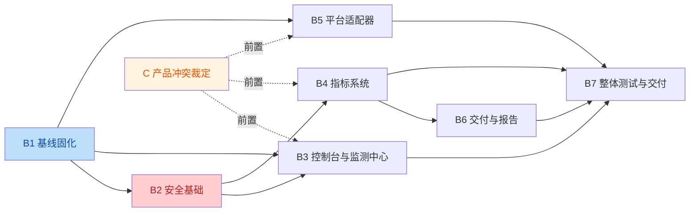

# 阶段2B实施计划 R1（A10）

- 文档编号：A10
- 依据：《阶段2A执行授权任务书》第七章；商业产品基线 R1.0
- 状态：**计划草案。不构成阶段2B授权；阶段2B需负责人书面批准后另行签发。**
- 前置：阶段2A全部交付物通过验收

> 本文件不含工期承诺。批次顺序按依赖关系排列，可并行项已注明。

---

## 一、阶段2B启动前置条件（全部满足方可开始）

| 序号 | 条件 | 当前状态 |
|---|---|---|
| 1 | 阶段2A十项交付通过验收 | 未验收 |
| 2 | 正式技术基线已确认（含未跟踪依赖） | 未建立 |
| 3 | 可验证备份与恢复点 | 未建立 |
| 4 | 开发分支建立 | 未建立 |
| 5 | A08 中 C-1～C-5 产品冲突已裁定 | 未裁定 |
| 6 | 测试环境与隔离凭据就绪 | 未就绪 |
| 7 | 负责人书面批准阶段2B | 未批准 |

---

## 二、批次划分

### 批次 B1：开发环境及基线固化

| 项 | 内容 |
|---|---|
| 目标 | 建立可复现、可恢复的正式基线 |
| 任务 | 建立 `baseline/r1.0`；创建备份与恢复点；将必要未跟踪模块纳入版本管理；锁定依赖；完成基础构建验证 |
| 输入 | A01 资产清单、A02 变更来源表、A03 规范 |
| 产出 | 基线提交、依赖清单、构建记录 |
| 验收 | 干净环境可构建启动；依赖完整；备份可恢复 |
| 风险 | 未跟踪依赖纳入范围判断错误 → 以 A01 清单为准，逐项确认 |
| 依赖 | 无 |

### 批次 B2：安全基础能力

| 项 | 内容 |
|---|---|
| 目标 | 关闭 A08 P0 全部项 |
| 任务 | 统一认证与权限；监测接口鉴权；写入权限；HTML 安全渲染；日志脱敏；审计；客户数据隔离（一期范围待定） |
| 输入 | A08 P0-1～P0-6 |
| 产出 | 代码变更 + 安全测试报告 |
| 验收 | A09 S-01～S-10 全部通过 |
| 风险 | 鉴权设计影响既有调用方 → 先梳理调用方清单 |
| 依赖 | B1 |

### 批次 B3：综合控制台与监测中心整合

| 项 | 内容 |
|---|---|
| 目标 | 落实“综合控制台＋独立监测中心” |
| 任务 | 按 A05 裁定保留/迁移/退役旧功能；监测中心独立成页并可互跳；导航与权限整合；历史与项目数据兼容 |
| 输入 | A05 映射、A04 架构 |
| 产出 | 双页/新外壳实现 + 功能回归 |
| 验收 | A05 保留项 100% 可用；退役项有批准记录 |
| 风险 | 旧功能边界不清 → 以负责人裁定为准，不自行删除 |
| 依赖 | B1；与 B2 可部分并行，但导航权限需在鉴权后完成 |

### 批次 B4：指标系统建设

| 项 | 内容 |
|---|---|
| 目标 | 统一指标词典落地 |
| 任务 | 实现 `metrics-dictionary.md`；统一计算入口；真实/模拟/异常分离；“最新操作”与“最近真实”分开；建立验证样本与回归测试 |
| 输入 | A06 词典、A04 架构 |
| 产出 | 指标服务 + 公式测试报告 |
| 验收 | A09 M-01～M-10 通过 |
| 风险 | 基线三项与 v0.1 三项关系未定 → 需产品先裁定 |
| 依赖 | B2（数据隔离）、C-5 裁定 |

### 批次 B5：平台适配器优化

| 项 | 内容 |
|---|---|
| 目标 | 适配器可配置、可观测、可控制 |
| 任务 | 核验各平台接口；Kimi 保持可选试验并移出默认预设；异常分类；并发与总超时；平台健康与成本记录 |
| 输入 | A04 第五章、基线 5.2/5.3 |
| 产出 | 适配器改造 + 供应商验证报告 |
| 验收 | Kimi 默认关闭；异常不伪装成功；超时可控；成本可统计 |
| 风险 | 供应商接口变更 → 以实测契约为准 |
| 依赖 | B1；与 B4 部分并行 |

### 批次 B6：客户交付与报告能力

| 项 | 内容 |
|---|---|
| 目标 | 形成客户可理解、可复核的交付物 |
| 任务 | 诊断报告、竞品分析、优化任务记录、阶段报告、客户确认记录 |
| 输入 | A04 第七章、A07 交付标准 |
| 产出 | 报告模板与生成流程 |
| 验收 | 报告含口径、平台、问题数、时间范围与证据索引；无模拟成绩 |
| 风险 | 交付边界未定 → 依赖 A07 负责人填写 |
| 依赖 | B4（真实指标） |

### 批次 B7：整体测试及交付

| 项 | 内容 |
|---|---|
| 目标 | 全量验证并形成可发布版本 |
| 任务 | 单元、集成、安全、多租户、指标公式、性能、构建、部署包与交付文档 |
| 输入 | A09 测试计划 |
| 产出 | 测试报告、部署包、发布说明 |
| 验收 | A09 全部 P0 通过；无未关闭高危项 |
| 风险 | 性能回归 → 以 P-01～P-06 为准 |
| 依赖 | B2～B6 |

---

## 三、批次依赖关系

---

## 四、批次与产品决策的对应

| 产品决策 | 落实批次 |
|---|---|
| 综合控制台＋独立监测中心 | B3 |
| 2,800＋4,800＋企业定制 | B6（A07 定稿后） |
| Kimi 可选试验，不入默认 | B5 |
| 旧术语禁用、新术语验证后启用 | B4 |

---

## 五、风险登记

| 编号 | 风险 | 影响 | 缓解 |
|---|---|---|---|
| RK-1 | 未跟踪依赖范围判断错误 | 基线不可复现 | A01 清单逐项确认，构建冒烟验证 |
| RK-2 | 旧控制台功能误删 | 违反基线 3.2 | B3 严格按 A05 与负责人裁定 |
| RK-3 | Kimi 默认开启未撤销 | 违反基线 5.2 | B5 首批处理 |
| RK-4 | 指标口径二次分裂 | 对客数据不可比 | B4 单一计算入口 + 词典版本绑定 |
| RK-5 | 鉴权改造破坏既有调用 | 业务中断 | 先建调用方清单与兼容期 |
| RK-6 | 长探测触发 worker 超时 | 请求失败 | B5 并发 + 总超时，或转队列 |
| RK-7 | 数据落容器层丢失 | 数据不可恢复 | B1 显式数据目录 + 卷挂载 |

---

## 六、停止条件（沿用任务书）

遇到以下情况立即停止并报告：无法确认正式基线；无法确认关键源码来源；候选文件可能覆盖现有资产；发现新的高优先级安全风险；产品决策冲突未裁定；需要超出授权的写操作、Git 写操作、生产数据库或公网配置访问。

---

## 七、需负责人批准

1. 是否批准阶段2B启动，以及启动顺序（建议 B1 → B2 → B3/B4/B5 并行 → B6 → B7）。
2. B2 中客户数据隔离是否列入一期。
3. B3 采用 A05 的方案A/B/C 哪一个。
4. 是否允许真实供应商调用测试及其费用上限。
5. 各批次验收人与验收标准确认人。
